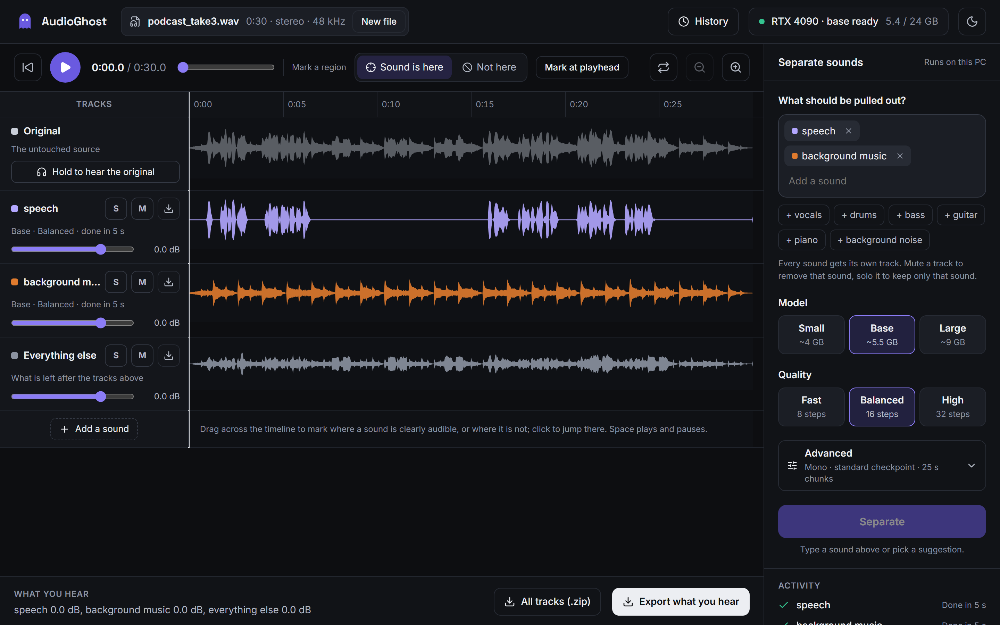
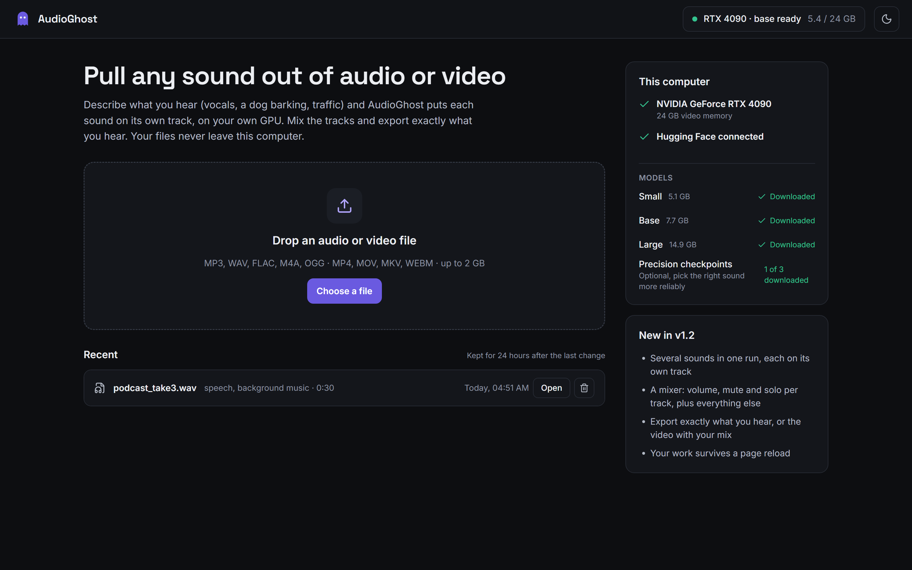

# AudioGhost AI 🎵👻


**Pull any sound out of audio or video**

Describe the sounds you want (vocals, a dog barking, traffic) and AudioGhost puts each one on its own track. Mix the tracks and export exactly what you hear, or your video with the new soundtrack. Powered by Meta's [SAM-Audio](https://github.com/facebookresearch/sam-audio), running locally on your own GPU, with no account to create.

  

## 🆕 What's new

**No Hugging Face account needed anymore.** The models now download from AudioGhost's own copies ([audioghostai](https://huggingface.co/audioghostai)) the first time you use them: no access request, no waiting for Meta's approval, no token. The downloads are also less than half the size (Small 1.4 GB instead of 5.1 GB, Large 6.3 GB instead of 14.9 GB), and they load into the same weights as Meta's checkpoints, bit for bit. [How it works](#first-run-accept-the-model-license)

### v1.2

| | |
|---|---|
| 🎼 **Several sounds, one run** | Type `speech`, `background music`, `drums`... and each sound lands on its own track. An **Everything else** track holds what is left |
| 🎚️ **A mixer** | Volume, mute and solo per track, plus *hold to hear the original*. Everything you hear is SAM-Audio's own output: mute one track and you get the model's own mix without that sound |
| 💾 **Export what you hear** | One mixed file, single tracks as a ZIP, or your video with the new soundtrack: 24-bit WAV, FLAC or MP3, named like `song [no vocals].wav` |
| 🕒 **Mark where a sound is, or isn't** | Drag on the timeline: *Sound is here* or *Not here*, per sound |
| 🔄 **Nothing gets lost** | Sessions survive page reloads and restarts; recent work stays one click away for 24 hours |
| 🧭 **A new interface** | One workspace instead of a long form, system status in the top bar, dark and light themes, keyboard friendly ([screenshots](#-demo)) |
| 🔗 **Everything else, made by the model** | Each new sound is removed from what the earlier ones left, so *Everything else* is real model output that still sounds like your recording (24 s stereo café recording: 9 s for the first sound, 14 s for each one after it; Large, Balanced, RTX 4090) |

v1.1 made separation 4–6× faster, fixed the installers and added macOS & Linux. Full list in the [CHANGELOG](CHANGELOG.md).

## 🎬 Demo

https://github.com/user-attachments/assets/4dd5dc31-f28e-4f7f-924c-d3eeac3f7f7d

A real field recording ("New Orleans ambience" by cognito perceptu, CC0). AudioGhost finds the band, plays just the band, then takes it out. Turn the sound on.



<details>
<summary>Start screen</summary>



</details>

## Features

- 🎯 **Text-guided separation** - describe any sound: "vocals", "drums", "a dog barking", "crowd noise"
- 🎼 **Multi-track** - several sounds per run, each on its own track, plus everything else
- 🎚️ **Mixer** - volume, mute, solo and *hold to hear the original*; all tracks play in sync
- 🎬 **Video** - preview the video with your mix and export it with the new soundtrack
- 🕒 **Temporal Lock** - mark where a sound is (or isn't) audible to point the model at the right source
- 🚀 **Consumer GPUs** - Small runs in ~4.2 GB of VRAM; long files are processed in crossfaded chunks
- ⚡ **Speed / Quality presets** - Fast (8 steps), Balanced (16, Meta's default), High (32)
- 🎧 **Stereo** - per-channel separation that keeps the stereo image (on by default for stereo files)
- 💾 **Exports** - 24-bit WAV, FLAC, MP3 or a ZIP of single tracks, with readable names
- 🔄 **Sessions** - your work survives reloads and restarts (kept for 24 hours)
- 🔓 **No account** - the models download on first use, no Hugging Face login

## ⚡ Performance

4:26 stereo song (`"singing voice"`), RTX 4090 (24 GB), Windows 11, 25 s chunks, Balanced quality.
"v1.0" is v1.0's inference path run on the same machine with the same weights.

| Model | v1.0 | **v1.1** | v1.1 Fast | v1.1 Stereo | Peak VRAM v1.1 (auto batch / low-VRAM) |
|---|---|---|---|---|---|
| Small | 95 s | **17 s** (16× realtime) | 14 s | 31 s | 6.3 GB / 4.2 GB |
| Base | 104 s | **20 s** (14× realtime) | 15 s | 39 s | 7.5 GB / 5.4 GB |
| Large | 120 s | **30 s** (9× realtime) | 20 s | 60 s | 11.0 GB / 8.9 GB |

- The batch size is chosen from free VRAM; on smaller GPUs AudioGhost automatically runs one chunk at a time and decodes one clip at a time ("low-VRAM" column: ~3× slower than the auto batch, still faster than v1.0). Shorter chunks need even less memory.
- Loading a downloaded model is disk-bound: a few seconds from a fast SSD with a warm cache, longer from a slow disk.
- First use of a model also downloads it: Small 1.4 GB, Base 2.7 GB, Large 6.3 GB, plus the 0.9 GB text encoder once (Meta's original checkpoints are 5.1, 7.7 and 14.9 GB). v1.0 additionally downloaded ~25 GB of ImageBind (4.8 GB), CLAP (1.9 GB), SAM-Audio-Judge (12.3 GB) and PE-A-Frame (5.8 GB) weights it never used.
- Reproduce on your machine: `python scripts/benchmark.py --file song.mp3 --model base`.

<details>
<summary>What changed under the hood (v1.0 → v1.1)</summary>

| | v1.0 | v1.1 |
|---|---|---|
| Model loading | `from_pretrained()` builds every sub-model (vision encoder, ImageBind, CLAP, Judge, span predictor), then deletes them | Builds only what text prompting uses, skips random init, memory-maps the checkpoint |
| Audio codec | cuDNN disabled by SAM-Audio → slow fallback convolutions and a per-timestep LSTM loop | Same computation with cuDNN (falls back automatically if cuDNN rejects a shape) |
| Precision | Whole model bf16, wrapped in fp16 `autocast` (so "float32" mode wasn't fp32 either) | fp16 transformer; T5, codec, RoPE and the ODE state in fp32 |
| Chunking | Hard cuts every 25 s, tail < 1 s dropped, one chunk at a time | Equal chunks, 2 s crossfades, shared noise, batched |

</details>

## Requirements

- **Windows 10/11** or **Linux (x86_64)** with an **NVIDIA GPU**, or a **Mac with Apple Silicon** (CPU only for now, so expect minutes rather than seconds; Intel Macs are not supported by PyTorch 2.9)
- **NVIDIA GPU**: 6 GB+ for Small, 8 GB+ for Base, 12 GB+ for Large (measured peaks: 4.2 / 5.4 / 8.9 GB with 25 s chunks; shorter chunks need less)
- **Anaconda / Miniconda**, **Node.js 18+** and **git**
- **No Hugging Face account**: the models download from AudioGhost's own copies the first time you use them. An account with access to Meta's repos is only needed for the optional `-tv` precision checkpoints.

> 💡 PyTorch, FFmpeg and Redis are installed by the installers. RTX 50-series cards get the CUDA 12.8 build automatically.

## 🚀 One-Click Installation (Recommended)

### Windows

```bash
# First time: creates the 'audioghost' conda env, installs everything (pinned), downloads Redis and FFmpeg
install.bat

# Every day
start.bat     # starts Redis, API, worker and the web UI, then opens http://localhost:3000
stop.bat      # stops only AudioGhost's own windows
```

### macOS (Apple Silicon) / Linux (x86_64)

```bash
./install.sh  # conda env, PyTorch (CUDA build on Linux with an NVIDIA GPU), FFmpeg 7, Redis via Homebrew/apt
./start.sh    # starts Redis, API, worker and web UI in the background (logs in ./logs), opens the browser
./stop.sh     # stops exactly what start.sh started
```

On a Mac, SAM-Audio runs on the CPU: fine for short clips, slow for whole songs. The Apple GPU path can be tried with `AUDIOGHOST_DEVICE=mps ./start.sh` (experimental).

Updating an existing install: `git pull`, then run the installer again (it re-applies the version pins).

## First run: accept the model license

The first time, AudioGhost shows Meta's **SAM License**, which comes with the SAM-Audio weights. Accept it once, with the start screen's *Review* button or when you first press *Separate*. The model then downloads on first use:

| | Small | Base | Large |
|---|---|---|---|
| NVIDIA GPU (fp16) | 1.4 GB | 2.7 GB | 6.3 GB |
| Mac or CPU (fp32) | 2.4 GB | 5.0 GB | 12.2 GB |

The 0.9 GB text encoder is downloaded once for all sizes. Models are stored in the Hugging Face cache; to put them on another drive, see [Not enough disk space](#not-enough-disk-space-for-the-models).

The models come from [audioghostai](https://huggingface.co/audioghostai), AudioGhost's copies of Meta's weights:
- **What changed:** each size comes as an fp16 file (the default on NVIDIA GPUs; it loads into exactly the values AudioGhost used before) and an fp32 file (Macs, CPUs and *Full FP32*). The vision encoder, which only visual prompting needs, is left out, and the files are safetensors. `model_hub/` builds and publishes them.
- **Meta's own checkpoints:** if they are already in your Hugging Face cache, AudioGhost uses them as they are.
- **The `-tv` precision checkpoints:** these are still Meta's only. Use *Connect* on the start screen with a Read token from an account that has access.

## Usage

1. **Upload** an audio or video file (drag & drop or *Choose a file*). It shows up under **Recent**, and the page URL points to it, so a reload never loses your work.
2. **Type the sounds you want**, one at a time (Enter), or pick a suggestion: "speech", "vocals", "background music", "a dog barking", "traffic"... Each becomes its own track.
3. Optional:
   - **Mark where a sound is**: select a new sound in the panel, then drag across the timeline with *Sound is here* or *Not here* (or use *Mark at playhead*). It's a hint; the whole file is still processed
   - **Model** and **Quality**: Small / Fast for drafts, Large / High for final exports
   - **Advanced**: stereo (on for stereo files; off is about twice as fast but mono), Meta's precision (`-tv`) checkpoints (need a Hugging Face account), full FP32, max chunk length
4. Click **Separate**. Tracks appear as they finish, so you can listen to one while the next is running. Cancel a track with its ✕.
5. **Mix**: S (solo), M (mute) and a volume slider per track, *Hold to hear the original* to compare, Space to play and pause. What you hear is always model output, picked by what you changed: everything at 0 dB plays the original; one track changed plays the model's own "without that sound" plus the track at your level; more changes play **Everything else** (the model removes each sound in turn from what the previous ones left) plus every track. Removing a finished track puts its sound back into Everything else.
6. **Export** what you hear as one file, single tracks as a ZIP, or (for videos) the video with your mix.

### Command line

```bash
python sam_audio_lite.py song.mp3 "singing voice" --accept-license   # the first time: accepts Meta's SAM License
python sam_audio_lite.py interview.mp4 "background music" --model base --quality fast -o out/
python sam_audio_lite.py live.flac "crowd noise" --stereo --start 12.5 --end 16 --format flac
```

## Manual Setup (Advanced)

<details>
<summary>Step by step, without the installers</summary>

### 1. Start Redis

`install.bat` downloads Redis to `redis/`. With Docker instead:
```bash
docker-compose up -d
```

### 2. Create the environment

```bash
conda create -n audioghost python=3.11 -y
conda activate audioghost
```

### 3. Install PyTorch 2.9

```bash
# RTX 20/30/40-series (CUDA 12.6)
pip install torch==2.9.0+cu126 torchvision==0.24.0+cu126 torchaudio==2.9.0+cu126 --index-url https://download.pytorch.org/whl/cu126 --extra-index-url https://pypi.org/simple
# RTX 50-series: replace cu126 with cu128 (all three packages and the index URL)
```

### 4. Install FFmpeg (required by TorchCodec)

**Windows:** download an FFmpeg 8 *shared* build - e.g. [`ffmpeg-n8.1-latest-win64-lgpl-shared-8.1.zip`](https://github.com/BtbN/FFmpeg-Builds/releases/tag/latest) - unzip it and add its `bin` folder to `PATH` (this is what `install.bat` does). Avoid conda-forge's FFmpeg on Windows for now: its packages currently ship two different `intl-8.dll` files, which breaks loading ([#10](https://github.com/0x0funky/audioghost-ai/issues/10)).

**macOS / Linux:**
```bash
conda install -c conda-forge "ffmpeg=7" -y
```

### 5. Install SAM-Audio (pinned)

```bash
pip install -c backend/constraints.txt "git+https://github.com/facebookresearch/sam-audio.git@bb4c6999d2677c7402360e426afc01ddfad6dce0"
```

`backend/constraints.txt` keeps torch, torchcodec and xformers on the tested versions - without it pip may swap your CUDA build of PyTorch for a CPU build. (On Apple Silicon follow `install.sh`, which installs SAM-Audio without decord/xformers.)

### 6. Install backend dependencies

```bash
cd backend
pip install -c constraints.txt -r requirements.txt   # also pins transformers<5 and huggingface_hub<1.0
```

### 7. Install frontend dependencies

```bash
cd frontend
npm ci
```

### 8. Start services

**Terminal 1 - Backend API:**
```bash
cd backend
uvicorn main:app --port 8000
```

**Terminal 2 - Celery Worker:**
```bash
conda activate audioghost
cd backend
celery -A workers.celery_app worker --loglevel=info --pool=solo
```

**Terminal 3 - Frontend:**
```bash
cd frontend
npm run dev
```

### 9. Open the app

Navigate to `http://localhost:3000`, then [accept the model license](#first-run-accept-the-model-license).

</details>

## Configuration (environment variables)

| Variable | Default | Meaning |
|---|---|---|
| `AUDIOGHOST_PRECISION` | `fp16` | Transformer precision when *Full FP32* is off: `fp16`, or `bf16` (uses the fp32 model files) |
| `AUDIOGHOST_PRELOAD_MODEL` | - | `small` / `base` / `large`: load a model when the worker starts |
| `AUDIOGHOST_DEVICE` | auto | Force `cuda`, `cuda:1`, `cpu`, or `mps` (Apple GPU, experimental; runs in fp32 unless `AUDIOGHOST_PRECISION` is set) |
| `AUDIOGHOST_SAFE_CODEC` | `0` | `1` = use SAM-Audio's original (slow, cuDNN-off) codec path |
| `AUDIOGHOST_RETENTION_HOURS` | `24` | Delete uploads/results older than this (`0` = keep) |
| `AUDIOGHOST_MAX_UPLOAD_MB` | `2048` | Upload size limit |
| `AUDIOGHOST_REDIS_URL` | `redis://localhost:6379/0` | Celery broker / result backend |
| `HF_HOME` | `~/.cache/huggingface` | Where downloaded models are stored |
| `AUDIOGHOST_MODEL_DIR` | - | A folder of model files laid out like the repos (`sam-audio-<size>/`, `sam-audio-shared/`), used instead of downloading |
| `AUDIOGHOST_MODEL_ORG` | `audioghostai` | Hugging Face organization the models download from (for a mirror) |
| `NEXT_PUBLIC_API_BASE` | `http://localhost:8000` | Where the web UI finds the API |

## API Reference

Interactive docs: `http://localhost:8000/docs`

### Sessions (v1.2)

| Method | Path | Purpose |
|---|---|---|
| `POST` | `/api/sessions` | Upload a file (multipart `file`); returns the session |
| `GET` | `/api/sessions` | Recent sessions |
| `GET` | `/api/sessions/{id}` | A session with its tracks, progress and file URLs |
| `DELETE` | `/api/sessions/{id}` | Delete a session |
| `POST` | `/api/sessions/{id}/separate` | Queue one or more prompts, one track each (JSON below) |
| `DELETE` | `/api/sessions/{id}/tracks/{track}` | Cancel a running track, or remove a queued or finished one |
| `GET` | `/api/sessions/{id}/files/{name}` | Audio, waveform overviews and the source video (Range requests) |
| `POST` | `/api/sessions/{id}/export` | `kind`: `mix`, `tracks` (ZIP) or `video`; `format`: `wav`, `flac` or `mp3`; `gains`: linear gain per track id and `"rest"`; `tracks`: ids for `tracks` |
| `GET` | `/api/system/status` | Redis and worker status, GPU, loaded model |
| `GET` | `/api/auth/status` | Models on this computer, license accepted, Hugging Face connection |
| `GET` | `/api/models/license` | Meta's SAM License text, and whether it was accepted |
| `POST` | `/api/models/license/accept` | Accept it (once, before the first model download) |

```json
{
  "prompts": [
    { "text": "speech" },
    { "text": "background music", "anchors": [["+", 12.0, 18.5], ["-", 40.0, 44.0]] }
  ],
  "model_size": "base", "quality": "balanced", "variant": "default",
  "stereo": true, "use_float32": false, "chunk_duration": 25
}
```

Anchors are optional: `"+"` = the sound is audible here, `"-"` = it isn't (start and end in seconds). While the model still has to be downloaded, `separate` answers 409 until the license is accepted, and 401 for `-tv` without a Hugging Face token.

<details>
<summary>Single-task API (v1.1, still supported)</summary>

| Method | Path | Purpose |
|---|---|---|
| `POST` | `/api/separate/` | Create a task (multipart form, see below) |
| `POST` | `/api/separate/batch` | One task per description for the same file (`descriptions` = JSON array) |
| `GET` | `/api/tasks/{task_id}` | Status, progress, queue position, result |
| `DELETE` | `/api/tasks/{task_id}` | Cancel (running tasks stop at the next diffusion step) |
| `GET` | `/api/tasks/{task_id}/download/{original\|ghost\|clean\|video}` | Result file; add `?format=wav\|flac\|mp3` to download with a readable name |
| `GET` | `/api/tasks/{task_id}/download-all?format=wav` | ZIP with all stems |
| `GET` | `/api/tasks/{task_id}/download-video-with-audio/{original\|ghost\|clean}` | Video with the audio track replaced |
| `GET` | `/api/system/status` | Redis / worker status |

`POST /api/separate/` form fields: `file`, `description`, `mode` (`extract`/`remove`), `model_size` (`small`/`base`/`large`), `model_variant` (`default`/`tv`), `quality` (`fast`/`balanced`/`high`), `chunk_duration` (5-60), `use_float32`, `stereo`, optional `start_time` + `end_time` (Temporal Lock) and `seed`.

```json
{ "task_id": "uuid", "status": "pending", "message": "Task submitted successfully" }
```

`ghost` = the described sound, `clean` = everything else.

</details>

## Troubleshooting

### `TypeError: BaseModel._from_pretrained() missing 2 required keyword-only arguments: 'proxies' and 'resume_download'`
Your `huggingface_hub` is 1.x. Run `pip install -r backend/requirements.txt` (pins `transformers<5`, `huggingface_hub<1.0`) or re-run `install.bat`.

### `Could not load libtorchcodec` / TorchCodec DLL errors
TorchCodec needs FFmpeg's shared libraries (FFmpeg 4-8). On Windows re-run `install.bat` (it downloads FFmpeg 8.1 into `ffmpeg\` and `start.bat` puts it on `PATH`), or install an FFmpeg 8 **shared** build from [BtbN](https://github.com/BtbN/FFmpeg-Builds/releases) or [gyan.dev](https://www.gyan.dev/ffmpeg/builds/) and add its `bin` folder to `PATH`, then restart the terminal. On macOS / Linux: `conda install -c conda-forge "ffmpeg=7" -y` inside the env.

### "Entry point not found ... libintl / gdk_pixbuf-2.0-0.dll" during install ([#10](https://github.com/0x0funky/audioghost-ai/issues/10))
conda-forge's Windows FFmpeg pulls in GTK packages, and two of them (`libglib` and `libintl`) currently install different `intl-8.dll` files. The one that wins lacks `libintl_bind_textdomain_codeset` and friends, so gdk-pixbuf shows this popup during install and TorchCodec later can't load FFmpeg. v1.1's `install.bat` no longer uses conda-forge's FFmpeg on Windows; it downloads a self-contained FFmpeg 8.1 build instead - just re-run it.

### Separation suddenly runs on the CPU / `torch.cuda.is_available()` is False
Something replaced the CUDA build of PyTorch (usually an unpinned `pip install` pulling a newer xformers). Re-run the installer, or reinstall PyTorch (manual setup step 3) and install packages with `-c backend/constraints.txt`.

### macOS: slow, or "Intel Macs are not supported"
Macs run SAM-Audio on the CPU by default - use the Small model, the Fast preset and short clips. PyTorch 2.9 only supports Apple Silicon. To try the Apple GPU: `AUDIOGHOST_DEVICE=mps ./start.sh` (experimental, feedback welcome).

### `CUDA error: no kernel image is available for execution on the device`
RTX 50-series GPUs need the CUDA 12.8 PyTorch build - re-run `install.bat`, or reinstall PyTorch with `cu128` (manual setup step 3).

### Out of memory / extremely slow processing
On Windows, running out of VRAM often doesn't crash - the driver spills into system RAM and everything slows down massively. Use the Small model, a shorter max chunk length (e.g. 15 s), turn off Stereo and Full FP32, and close other GPU apps. Peak usage is listed in the [performance table](#-performance).

### Not enough disk space for the models
Models are stored in the Hugging Face cache: `~/.cache/huggingface` (on Windows `C:\Users\<you>\.cache\huggingface`). To use another drive, set `HF_HOME` before starting AudioGhost: on Windows `setx HF_HOME D:\hf_cache`, then open a new terminal; on macOS / Linux add `export HF_HOME=/path/to/hf_cache` to your shell profile. Move the existing `hub` folder there to keep what you already downloaded.

### The page at localhost:3000 is a different app
Something else already uses port 3000, so Next.js picked the next free port (3001, 3002, ...) - check the "AudioGhost Frontend" window for the URL. The API accepts local ports 3000-3099.

### The status chip says the worker or Redis isn't running
The chip in the top-right corner turns amber or red; click it for details. Use `start.bat` (or `./start.sh`), which starts Redis, the API, the worker and the UI. For manual setups, start Redis before the worker ([#5](https://github.com/0x0funky/audioghost-ai/issues/5)). Right after start-up the worker needs about 20 s to load its libraries ("Worker starting..."); jobs you start meanwhile simply wait in the queue.

### HuggingFace 401 / 403
Only Meta's `-tv` precision checkpoints need an account. Reconnect in the UI. A 403 means your account hasn't been granted access to that model yet: open the model's page on Hugging Face (the `-tv` checkpoints are separate repos) and request access there.

### Offline use
Once a model is downloaded it loads from the Hugging Face cache without network or token. To install on a machine without internet, copy the files from [audioghostai](https://huggingface.co/audioghostai) into a folder laid out like the repos (`sam-audio-<size>/`, `sam-audio-shared/`) and set `AUDIOGHOST_MODEL_DIR` to it. The text encoder (`t5-base`) still loads from the Hugging Face cache, so copy that cache too and point `HF_HOME` at it.

## Architecture

```
┌─────────────────────────────────────────────────┐
│                   Frontend                       │
│             (Next.js + Tailwind v4)             │
└──────────────────────┬──────────────────────────┘
                       │
┌──────────────────────▼──────────────────────────┐
│               Backend API                        │
│            (FastAPI + Python)                    │
└──────────────────────┬──────────────────────────┘
                       │
┌──────────────────────▼──────────────────────────┐
│              Task Queue                          │
│          (Celery + Redis)                        │
└──────────────────────┬──────────────────────────┘
                       │
┌──────────────────────▼──────────────────────────┐
│        SAM-Audio Lite engine (sam_lite.py)       │
│  lite loader · mixed precision · batched,        │
│  crossfaded chunks · cuDNN codec                 │
└─────────────────────────────────────────────────┘
```

## Project Structure

```
audioghost-ai/
├── backend/
│   ├── main.py               # FastAPI app
│   ├── settings.py           # paths & env configuration
│   ├── sessions.py           # sessions: storage, "everything else", mixing, exports
│   ├── model_license.py      # Meta's SAM License (licenses/SAM_LICENSE.txt) and its acceptance
│   ├── constraints.txt       # tested versions of torch / torchcodec / xformers / transformers
│   ├── requirements-lean.txt # SAM-Audio deps for Apple Silicon (no decord / xformers)
│   ├── api/
│   │   ├── auth.py           # models on this computer; Hugging Face login (only for -tv)
│   │   ├── models.py         # model license API
│   │   ├── sessions.py       # v1.2 sessions API
│   │   ├── separate.py       # v1.1 single-task API (validation, streaming upload)
│   │   └── tasks.py          # v1.1 status, cancel, downloads, ZIP, video remux
│   ├── workers/
│   │   ├── celery_app.py     # Celery config
│   │   ├── tasks.py          # jobs (sessions, v1.1 tasks), progress, cancel, heartbeat
│   │   ├── sam_lite.py       # SAM-Audio Lite engine
│   │   ├── model_files.py    # where each model comes from: AudioGhost's copies, Meta's cache, a local folder
│   │   ├── audio_io.py       # decode / encode / export helpers
│   │   ├── compat.py         # platform shims (xformers stand-in on Apple Silicon)
│   │   ├── dispatch.py       # runs jobs on Celery, or in-process in the desktop app
│   │   ├── memory_store.py   # in-memory stand-in for Redis (desktop app)
│   │   └── queue_state.py    # queue position, cancel flags, worker heartbeat, locks
│   └── tests/                # unit tests (python -m pytest backend/tests)
├── frontend/                 # Next.js app: src/components (Workspace, Timeline, SeparatePanel, ...),
│                             #   src/lib (multi-track player, API client)
├── desktop/                  # Windows desktop app (Tauri), in testing: see desktop/README.md
├── model_hub/                # builds and publishes the model files on huggingface.co/audioghostai
├── docs/images/              # screenshots
├── scripts/benchmark.py      # performance benchmark
├── sam_audio_lite.py         # command-line tool
├── install.bat / start.bat / stop.bat   # Windows
├── install.sh / start.sh / stop.sh      # macOS / Linux
├── CHANGELOG.md
└── QUICKSTART.md             # 中文快速指南
```

## 🗺️ Roadmap

- 🖱️ **Visual Prompting** - click an object in the video to isolate its sound (SAM 2.1 / [SAM 3.1](https://huggingface.co/facebook/sam3.1) masks + SAM-Audio `-tv`)
- 🖥️ **Desktop app** - one Windows installer with no conda, Redis or git to set up (in testing, see `desktop/`)
- 🎵 **Bundled samples** - royalty-free clips to try AudioGhost without your own files
- 🎚️ **Specialised engines** for standard music stems (BS-/Mel-RoFormer) next to SAM-Audio for "any sound"
- 🍏 **Apple GPU (MPS) by default** once it's verified on more Macs (opt in today with `AUDIOGHOST_DEVICE=mps`)

## License

AudioGhost is licensed under the MIT License. SAM-Audio's code and weights are licensed separately by Meta under the [SAM License](https://github.com/facebookresearch/sam-audio/blob/main/LICENSE): check its terms before commercial use. AudioGhost's copies of the weights ([audioghostai](https://huggingface.co/audioghostai)) are distributed under that same license, with a copy in each repo, and the app shows it before the first download; they are not made or endorsed by Meta. SAM-Audio's codec embeds an inaudible watermark in generated audio; AudioGhost leaves it intact.

## Credits

- [SAM-Audio](https://github.com/facebookresearch/sam-audio) by Meta AI Research
- **Core Optimization Logic**: Special thanks to [NilanEkanayake](https://github.com/NilanEkanayake) for the initial modifications in [Issue #24](https://github.com/facebookresearch/sam-audio/issues/24) that made VRAM reduction possible, to [oulianov](https://github.com/oulianov) for the "don't build unused modules" approach in [PR #3](https://github.com/0x0funky/audioghost-ai/pull/3), and to [ShmuelOps](https://github.com/ShmuelOps) for the macOS / Linux groundwork in [PR #7](https://github.com/0x0funky/audioghost-ai/pull/7) and [PR #8](https://github.com/0x0funky/audioghost-ai/pull/8)
- Built with ❤️ using Next.js, FastAPI, and Celery
